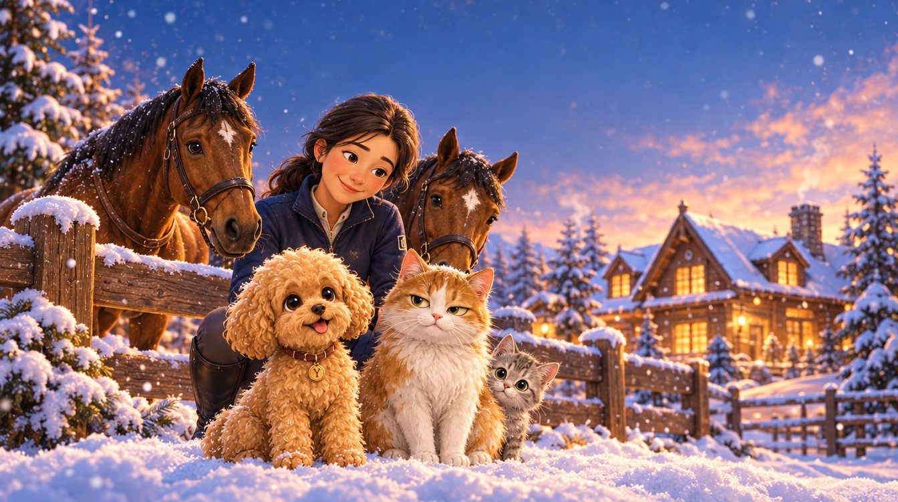

# Йонг

Маленькая собака большого мира

Тёплый семейный мультсериал о крошечной той-пудельке из Сеула, которая прилетает в Москву, получает новое имя и учится тому, что дом — это не место, а те, рядом с кем можно спокойно закрыть глаза.

Формат

6 серий по 10 минут, первый сезон

Зритель

семьи с детьми 4+, взрослые любители животных

Вид

3D-анимация уровня современных полнометражных мультфильмов Disney («Зверополис», «Энканто»)

Тон

уют, мягкий юмор, приключение, немного грусти

Рассказчик

мягкий ироничный закадровый голос

Тизер · серия 1

## «Йонг летит домой» за 44 секунды

1. **0:00**Женя вечером листает объявления и находит маленькую собачку из Кореи.
2. **0:04**Аэропорт Сеула: переноска, шум, огромный самолёт.
3. **0:09**Полёт: «Это что… весь мир из ваты?»
4. **0:13**Москва. Первая встреча: лапка на ладони.
5. **0:18**Загородный дом в снегу, тёплые окна.
6. **0:22**Зеркало: «Ты тоже Йонг? Понятно. Двойник».
7. **0:27**Вася на верхней ступеньке, «как памятник собственной важности».
8. **0:31**Ночь. «Ладно. Пусть пока остаётся».
9. **0:36**Название сериала.

Голоса · выбор

## Послушайте и выберите голоса

Нажмите ▶ у каждого варианта. Напишите в чат номер, например «Херра 3, рассказчик 2».

### Херра (Йонг) — выбрано

«Это домик? Нет. Не домик. Подозрительно! Драконы не дрожат! Ну… почти не дрожат.»

**1**Луня — мягкий голос маленькой феи

**✓****Выбрано:** Луня, выше — звонче

**3**Луня, совсем малышка — самый щенячий

**4**Мила, выше — сказочный звонкий

### Рассказчик

«Москва была огромной. Но у Йонг уже был плед, игрушка и человек рядом. А это значительно улучшало показатели проекта.»

**1**Мирон — харизматичный, актёрский

**✓****Выбрано:** Антон — глубокий, тёплый

**3**Андрей — низкий, спокойный

### Женя — выбрано

«Ты долетела… Умница. Я — Женя. А ты теперь — Йонг.»

**✓**Алиса — тёплый, естественный

Сезон

## Путь от неизвестности к дому

В начале Йонг боится всего: другого языка, климата, запахов, правил. Каждая серия — отдельное приключение, и в каждой она справляется с одним новым чувством. К Новому году страх сменяется уверенностью: рядом Женя, значит, всё будет хорошо.

1. Серия 1

   Находит дом и доверие к Жене.
2. Серия 2

   Встречает непринятие и делает первый шаг к дружбе.
3. Серия 3

   Учится заботиться о том, кто слабее.
4. Серия 4

   Открывает мир путешествий и радость нового.
5. Серия 5

   Преодолевает ревность и учится делить любовь.
6. Серия 6

   Становится смелее и встречает Новый год в своей семье.

Герои

## Кто живёт в большом доме

Листы персонажей — образец для всех следующих кадров: облик, пропорции, ошейники и мимика должны совпадать в каждой сцене.

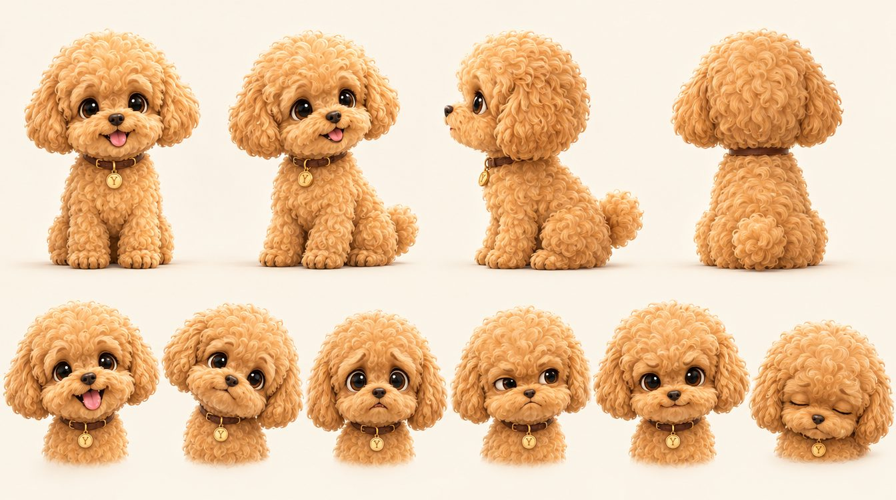

### Йонг

той-пудель · маленькая · весёлая · преданная

Прилетела из Сеула под именем Херра. Женя назвала её Йонг — по-корейски «дракон». Эмоциональная, любопытная, иногда ревнивая, но очень добрая. Мир для неё огромен, поэтому каждое открытие становится приключением.

«Я не слабая. Я просто… компактная».

**Как играть:** хвост живёт своей жизнью и выдаёт все чувства. Уши — главный индикатор страха. Камера чаще на уровне её глаз, чтобы мир казался большим.

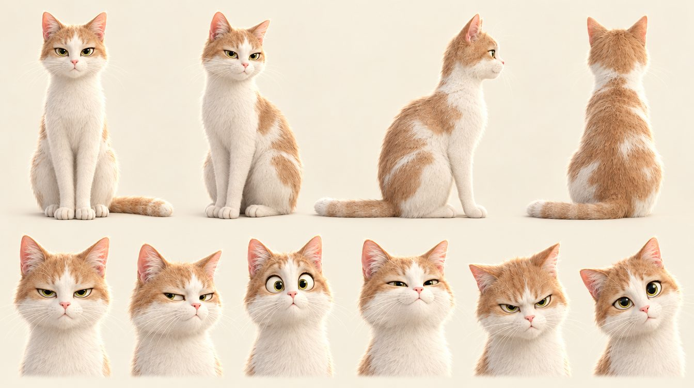

### Вася

светло-рыжий с белым кот · старожил · с характером · нарисован с настоящего Васи

Когда-то его самого нашли на улице, поэтому дом он охраняет даже от тех, кто пришёл с добром. Главный по дивану, тишине и стратегическим подоконникам. Умный, вредный, харизматичный, но не злой.

«Я не вредный. Я системный».

**Как играть:** минимум движений, максимум взгляда. Полуприкрытые глаза — его обычное лицо; распахнутые — значит, его действительно застали врасплох.

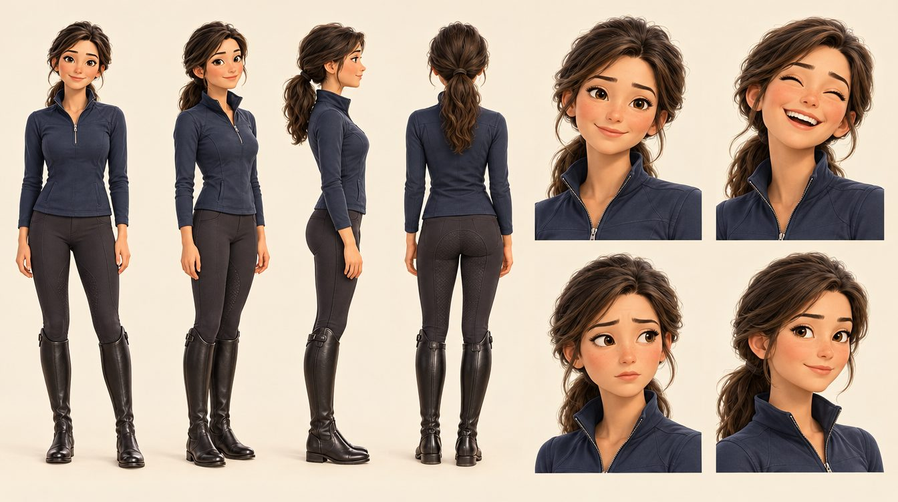

### Женя

хозяйка · добрая · спокойная · заботливая

Точка опоры для всех животных дома. Любит путешествия и занимается конкуром. Говорит тихо, не торопит, протягивает руку и ждёт. Её спокойствие — главный источник безопасности в сериале.

«Йонг — значит дракон. Но очень маленький. И очень красивый».

**Как играть:** мягкие, неспешные движения; она почти всегда опускается на уровень животных — садится на корточки или на пол.

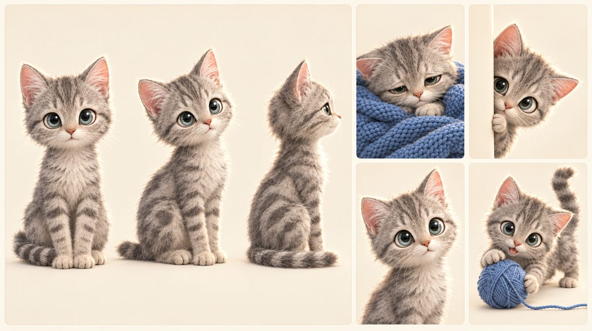

### Илюша

серебристый мраморный котёнок · нежный · любопытный · нарисован с настоящего Илюши

Брошенный, слабый и больной малыш, которого Женя приносит в серии 3. Рядом с ним Йонг впервые по-настоящему заботится о другом. К концу сезона окрепший Илюша смотрит на Йонг с восхищением.

«Мя?»

**Как играть:** почти без слов. Вся роль — в глазах, позе и том, к кому он прижимается.

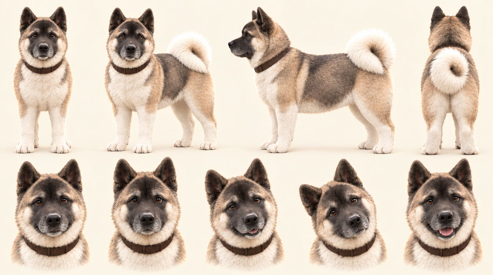

### Добрыня

американская акита · 10 лет · охранник двора · мудрый старший

Большой добрый пёс с чёрной, уже чуть поседевшей маской и белым хвостом-бубликом. Ему 10 лет, он старожил двора и появляется со второй серии. Нарисован с настоящего Добрыни. Спокойно объясняет Йонг, почему Вася колючий, что большие животные не обязательно опасные и что смелость — это не отсутствие страха.

«Когда долго живёшь без дома, потом начинаешь его охранять даже от тех, кто пришёл с добром».

**Как играть:** медленный, тяжёлый, тёплый. Говорит короткими фразами и делает паузы.

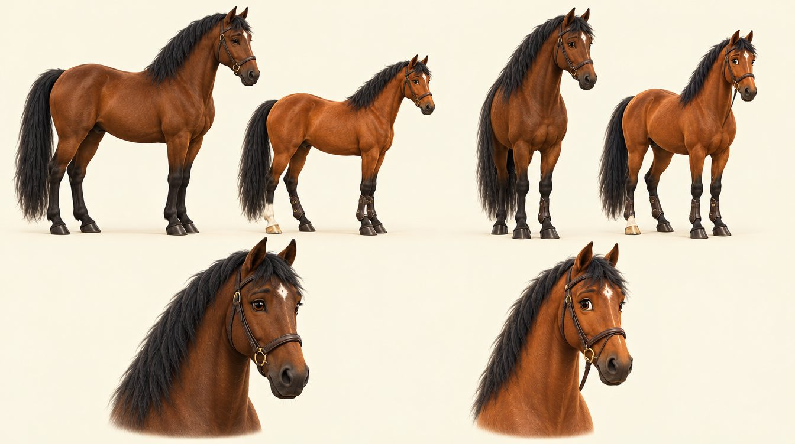

### Люся и Корнет

лошади Жени · конкур · серия 5

**Люся** (слева в каждой паре, крупная тёмно-гнедая, звёздочка на лбу) — добрая и мягкая, первой знакомится с Йонг. **Корнет** (справа, заметно ниже и светлее, белая бабка на задней ноге, коричневые ногавки; нарисован с настоящего Корнета) — невысокий, но статный и немного важный, как спортсмен перед стартом. Сначала Йонг их ревнует, потом принимает.

«Любовь не сено. Если дать одному — у другого не закончится».

**Как играть:** огромные рядом с Йонг; снимать снизу, но с тёплым светом, чтобы они казались величественными, а не страшными.

Визуальный стиль

## Ориентир — современная 3D-анимация Disney

Мы переводим акварельные эскизы в объёмную графику полнометражного уровня, сохраняя их уют: тёплый свет, мягкие формы и выразительные глаза.

### Формы говорят о характере

Йонг собрана из кругов: голова больше тела, лапки маленькие. Вася — груша с треугольными ушами. Добрыня — квадрат и тяжесть. Женя — мягкие плавные линии.

### Камера на уровне Йонг

Большинство кадров снимаем низко, с её высоты. Так обычные чемоданы, лестницы и коты становятся событием, а комедия масштаба работает сама.

### Тёплый дом, холодный мир

Внутри дома — янтарный свет ламп. Снаружи — синие сумерки и снег. Когда Йонг страшно, в кадре больше синего; когда спокойно — больше тёплого.

### Шерсть как отдельная роль

Кудряшки Йонг, пух Васи и бархат Илюши видны крупно. На них падает контровой свет, по ним читаются движение и настроение.

### Мимика крупно

Глаза большие и влажные, брови подвижные, морды умеют улыбаться. Эмоция должна читаться без слов, даже в кадре без звука.

### Цвет серии

У каждой серии своя гамма (ниже): золото облаков, сумерки и снег, свет лампы, бирюза моря, сено конюшни, синий с золотом новогодней ночи.

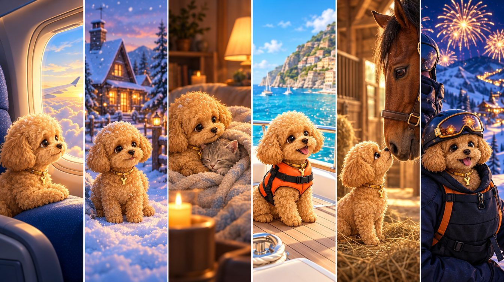

Главная локация — гостиная: лестница Васи, синий диван, лежанка Йонг, окно в снег.

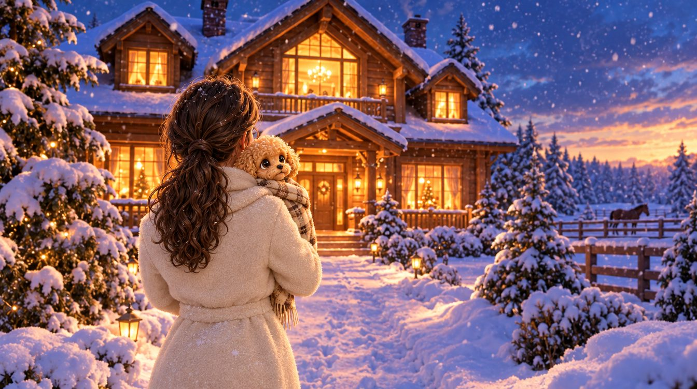

Дом снаружи: деревянный, двухэтажный, с тёплыми окнами и левадой для лошадей.

Йонг, абрикос Вася, светло-рыжий Илюша, серебро Женя, тёмно-синий свет лампы сумерки и снег

Серии

## Шесть приключений первого сезона

Полные сценарии всех серий готовы: по 12 сцен, около 10 минут каждая.

Серия 1

### Йонг летит домой

Новое имя, перелёт из Сеула, первая встреча с Женей и с недовольным Васей.

Сеул, самолёт, Москва, дом

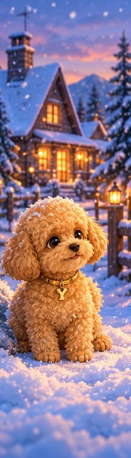

Серия 2

### Вася против нового жильца

Домашняя «холодная война». Йонг случайно помогает Васе, и наступает первое перемирие.

Дом, двор, Добрыня

Серия 3

### Серый малыш

Женя приносит больного котёнка. Йонг не отходит от лежанки, пока Илюша не поправится.

Дом ночью, лампа, лежанка

Серия 4

### Йонг едет на юг

Пальмы, набережная, велосипед, яхта и спасательный жилет. Маленький капитан у моря.

Ибица, море, закат

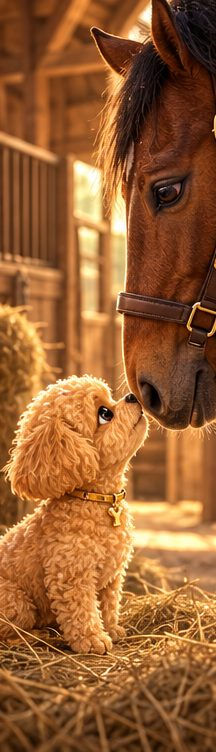

Серия 5

### Йонг и лошади

Ревность к Люсе и Корнету, переполох на конюшне и открытие: любви не становится меньше.

Конюшня, денники, манеж

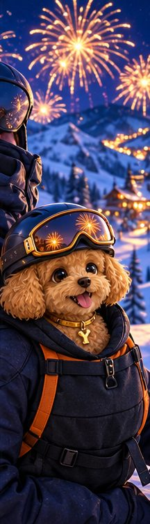

Серия 6

### Йонг на лыжах и встречает Новый год

Рюкзак на груди, шлем и очки, страх сменяется восторгом. Новогодняя ночь в своей семье.

Горный курорт, ночь, фейерверк

Кадры серии 1

## Ключевые кадры тизера

Сцена 1. Дом Жени

Сцена 3. Аэропорт Сеула

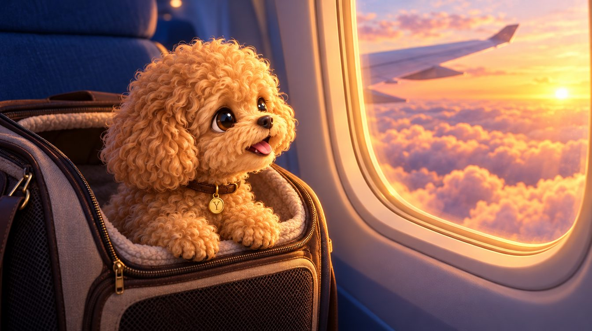

Сцена 4. Взлёт

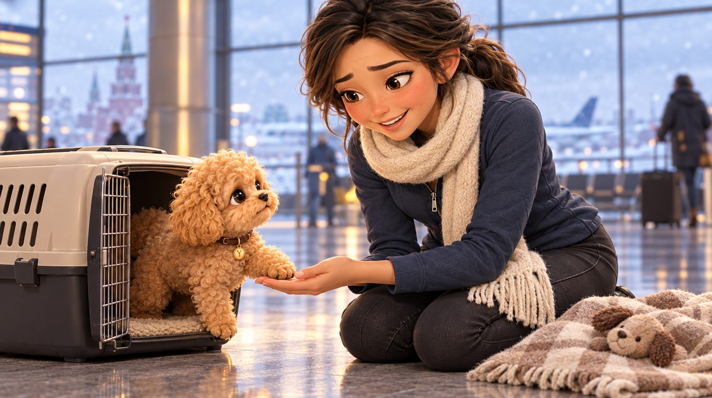

Сцена 6. Москва

Сцена 8. Приезд

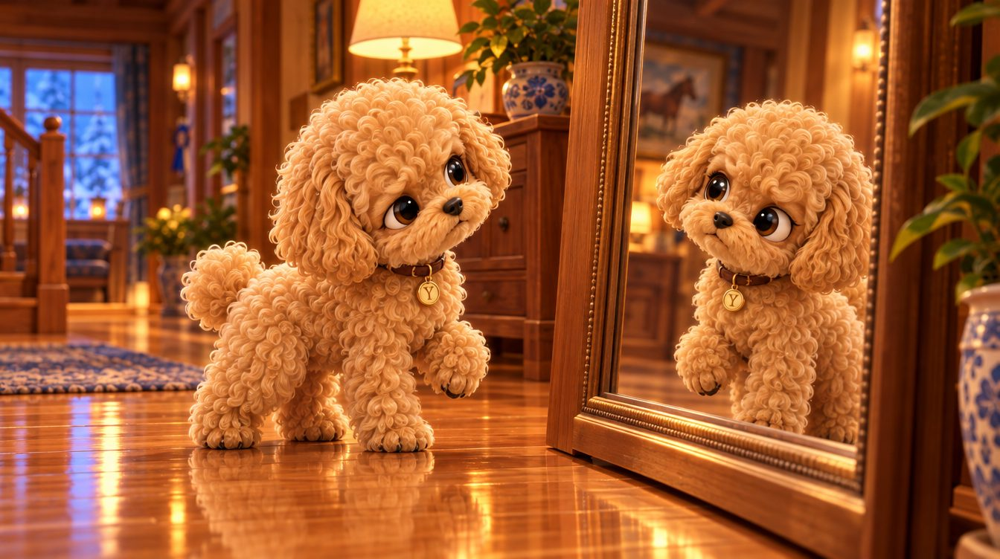

Сцена 9. Двойник

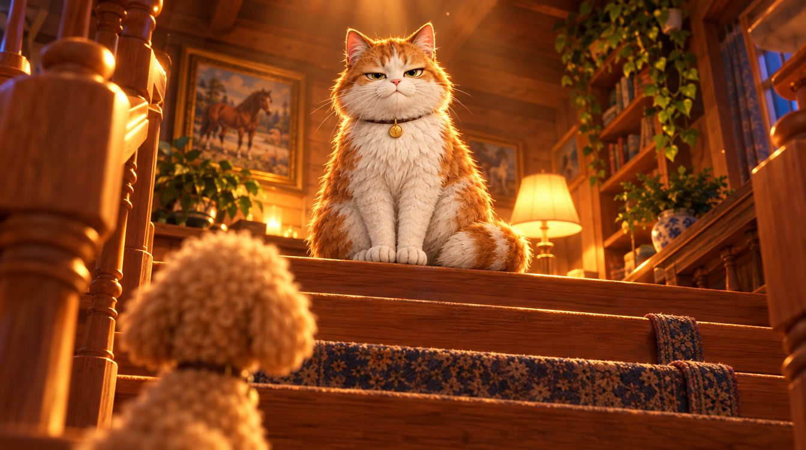

Сцена 11. Появление Васи

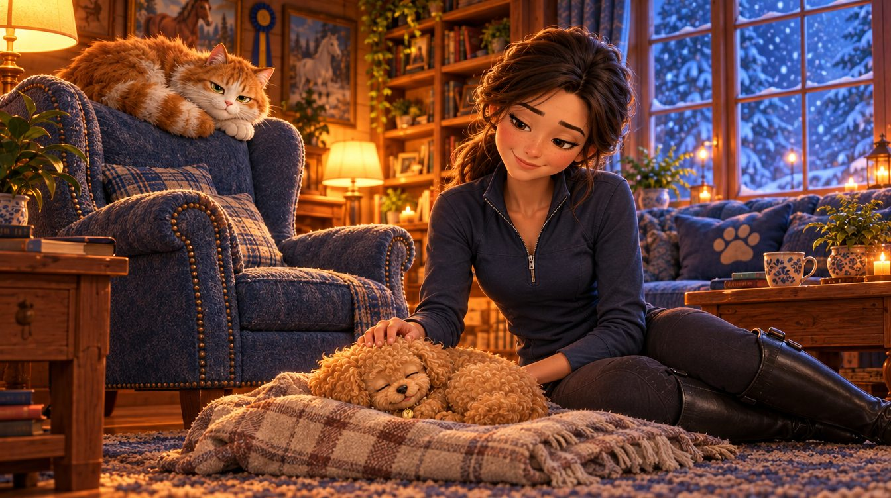

Сцена 12. Финал

Производство

## Что сделано и что дальше

Готово

### Сценарии и герои

- Синопсис, арка и 6 сценариев
- Листы 7 персонажей в 3D
- Цветовой сценарий сезона и главная локация
- Тизер серии 1

Следующий шаг

### Голоса

- Кастинг: Йонг, Вася, Женя, Добрыня, рассказчик
- Пробная запись сцены 11 (знакомство с Васей)

Следующий шаг

### Аниматик серии 1

- Раскадровка 12 сцен
- Черновая сборка под голос и музыку, около 10 минут

Потом

### Локации сезона

- Двор и будка Добрыни, конюшня, южный город, горный курорт
- Листы второстепенных героев: тренер, капитан, инструктор

Потом

### Пилот целиком

- Анимация серии 1 по аниматику
- Музыкальная тема сериала и звук

Потом

### Питч

- Презентация для каналов и платформ
- Смета и график сезона

Проект «Йонг. Маленькая собака большого мира». Изображения и видео созданы генеративными моделями по эскизам автора как образец стиля; это не финальная анимация.