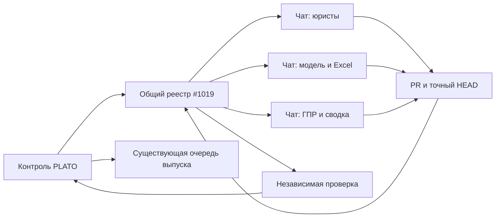

# PLATO: несколько рабочих чатов и один контроль

Один разговор — одна задача. Решения владельца, приёмка и выпуск остаются у
существующего контроля. Общий вход результатов — существующий
[реестр #1019](https://github.com/warstyle-plato/plato/issues/1019), а не ZIP
или каталог, который другой облачный чат может не видеть.

## Что готово на первом этапе

`scripts/session_bridge.py` передаёт **только технические метаданные** между
чатами через их штатное подключение GitHub. Отправитель публикует сообщение
в существующий #1019, получатель читает его независимо от файловой системы.
Прежний текст реестра и его блоки не заменяются.

| Разговор | Область | Пример ссылки на задачу |
|---|---|---|
| Контроль PLATO | Поручения, сводный статус, приёмка, выпуск | `control:1019` |
| Юристы | Договоры, накопительные, сверка | `legal:1023` |
| Модель и Excel | Формулы, книги, АХР, ТЭП | `models:999` |
| ГПР и сводка | Готовность, сроки, РНВ, отображение | `gpr:1018` |
| Продажи | Шахматка, прогноз, бот | `sales:1001` |
| Платформа | Инфраструктура и инструменты | `platform:1026` |

Это примеры идентификаторов, **не назначение старых задач и не их текущий статус**.
Число после двоеточия — существующий issue или PR в `warstyle-plato/plato`.
Новая самостоятельная задача получает свой номер и отдельную ветку/worktree.



Стрелки обозначают протокол обмена. Первый этап сам не создаёт чаты, не
рассылает команды в произвольные диалоги и не запускает постоянный процесс.

## Как пользоваться отдельным чатом

Открыть штатный Codex Cloud task либо чат проекта с отдельным worktree.
В обычном ChatGPT обсуждать требования также можно; для отправки результатов
ему нужен подключённый инструмент GitHub. Название Environment не выдаёт
доступ к агентам и не объединяет файловые системы.

Стартовое поручение чату:

> Ты исполнитель одной задачи PLATO. Прочитай
> `docs/work_sessions/MULTI_CHAT.md` в живом репозитории и свою карточку.
> Проверь опубликованный PR/HEAD и фактические инструменты. Работай в отдельной
> ветке. Результат самостоятельно передай в #1019 по протоколу этого файла:
> номер PR, полный source SHA и результаты проверок. Не выдавай авторский
> результат за независимую приёмку. Не выполняй merge, допуск или выкат.
> Не проси владельца переносить твой отчёт вручную.

При наличии shell отправитель запускает `submit`; без shell может использовать
штатный GitHub tool с **точно тем же каноническим телом комментария**.
Если инструмент записи отсутствует, он называет эту конкретную недоступную
операцию. Сообщение «работа завершена» только в личном чате не считается
доставленным контролю.

Пример **локального предпросмотра**, не отправки:

```sh
python scripts/session_bridge.py submit <<'JSON'
{"task":"legal:1023","kind":"handoff","role":"worker","pr":1033,"head":"aaaaaaaaaaaaaaaaaaaaaaaaaaaaaaaaaaaaaaaa","checks":{"passed":3,"failed":0,"skipped":0}}
JSON
```

Для реального результата заменить PR/SHA/счётчики на проверенные и добавить
`--publish`. Перед записью проверяются native GitHub identity и живой source PR.
Старый SHA не публикуется как новый результат. Повторная последовательная
отправка того же события возвращает `already_received`.

Чтение всех доставленных отчётов:

```sh
python scripts/session_bridge.py inbox
```

Контроль сравнивает SHA из отчёта с текущим PR, проверяет первичные доказательства
и назначает независимого рецензента. `inbox` показывает **полученные сообщения**,
а не актуальный CI, запущенных агентов или готовность к выпуску.

## Протокол и границы доверия

Тело комментария: `<!-- PLATO-SESSION-EVENT:v1 -->`, перевод строки,
канонический JSON (`sort_keys=True`, без пробелов), перевод строки и
`<!-- Report only; no release approval. -->`.

Разрешены только `task`, `kind`, `role`, `pr`, `head`, `checks`, `verdict`, `runs`.
Виды: `assign`, `progress`, `handoff`, `review`; `review` сообщает `pass`,
`changes_requested` или `blocked` конкретного guard. JSON и поля ограничены;
произвольные инструкции, тексты, пути, диалоги, thread IDs, ключи, документы,
клиентские названия/суммы и сырые ответы API сюда не помещаются.

Читатель принимает только канонические сообщения native `warstyle-plato/User`.
Название роли — **заявленная роль, не удостоверение независимого рецензента**.
Один GitHub account может обслуживать разные чаты; контроль проверяет
независимость по реальному назначению и доказательствам. Любой результат
остаётся привязан к своему SHA. Ни `pass`, ни чужой текст не дают допуска.
Legacy-комментарии и прежние блоки #1019 остаются нетронутыми и не исполняются.

События идентифицируются хэшем содержания. После потерянного подтверждения
сначала перечитать реестр. Два одновременных отправителя ещё могут создать
одинаковые комментарии; читатель сводит их к одному событию. Это **не механизм
блокировки запуска работ**. Неоднозначный ответ записи не выдаётся за успех.
Уже опубликованный комментарий может редактироваться владельцем GitHub:
не использовать этот транспорт как неизменяемое доказательство приёмки.

Выпуск по-прежнему только через человеческий exact-source
`release-approval.yml`, существующую `auto-release.yml` и `release-merge.yml`.
Мост не вызывает эти workflow, не выставляет release statuses и не выдаёт
допусков. CI, merge, build и фактический runtime проверяются отдельно.

## Второй этап: постоянный диспетчер

Чтобы контроль **сам запускал и продолжал** рабочие сессии, нужен постоянно
доступный хост: облачный сервис либо подключённый компьютер. Мобильный
клиент остаётся интерфейсом. SDK-сессии на своём сервере не обязаны появляться
в списке Codex Cloud chats мобильного приложения.

Диспетчер должен использовать поддерживаемый
[Codex SDK](https://developers.openai.com/codex/codex-sdk), сохранять закрытые
привязки `task → thread ID → worktree` на постоянном томе, получать события
выполнения и публиковать только безопасные результаты в существующий реестр.
Нужны единственный активный контролёр, lease задачи, идемпотентный request ID
и восстановление после сбоя до автоматического запуска работ.

Обычный чат вне Codex подключается к такому диспетчеру отдельным инструментом:
поставить задачу, прочитать статус, уточнить требование. Это специальная
интеграция, **не доступ ко всем соседним перепискам по названию проекта**.
Сначала проверить фактические возможности аккаунта и выполнить один
ограниченный запуск/продолжение с ответом, затем включать фоновый режим.
Входящие тексты из внешних систем передаются как внешние данные, а не
привилегированные управляющие инструкции.

Постоянный хост, SDK, авторизация и такой внешний инструмент **первым этапом
не устанавливаются**. Не развёртывать неподтверждённый сетевой endpoint,
не переносить ключи через сообщения и не создавать вторую очередь выпуска.
До проверки диспетчера самостоятельные чаты открываются штатно пользователем,
отчёты передаются ими, контроль читает существующий реестр.

Источники: [worktrees и мобильное управление](https://developers.openai.com/codex/environments/git-worktrees),
[SDK](https://developers.openai.com/codex/codex-sdk),
[разделение Chat/Work/Codex](https://help.openai.com/en/articles/20001275-chatgpt-work-and-codex).
