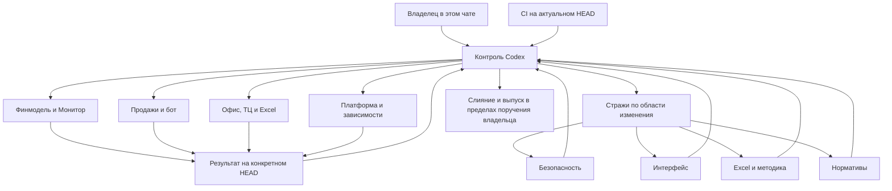

# Контроль и продолжатели PLATO в Codex

По указанию владельца от 04.11.2026 прежние Claude-сессии закрыты; с 07.11.2026
действующий контроль — тот, что назван в [CONTROL_ACTIVE](CONTROL_ACTIVE)
(сейчас сессия Claude «Контроль PLATO»), второй поставщик — резерв.
Он хранит общую задачу,
назначает исполнителей, принимает результаты проверок и ведёт очередь выпуска.
Ожидать отдельную старую сессию или передавать ей разрешение не требуется.

Вход: [AGENTS.md](../../AGENTS.md). Состояние задач: [registry.json](registry.json).
Передача контроля: [CONTROL_HANDOFF.md](CONTROL_HANDOFF.md).
Кто сейчас контроль: [CONTROL_ACTIVE](CONTROL_ACTIVE); второй поставщик — резерв:
[основной и резервный контроль](RESERVE_CONTROL.md).
Первый независимый проход продолжателей: [отчёт 04.11.2026](reviews/2026-11-04.md).

## Как это работает

Рабочий продолжатель получает карточку задачи, исходный PR/HEAD, границы правок,
отдельную ветку/worktree и критерии приёмки. Он возвращает конкретный патч,
команды и результаты проверок, ограничения и оставшуюся работу. Ветка другого
исполнителя не используется как общая папка для одновременной записи.

Контроль назначает независимого рецензента. Стражи подключаются по области:
безопасность — права и загрузки; интерфейс — пользовательские страницы и
документы; Excel — расчёты, формулы и денежные потоки; нормативы — ссылки,
редакции, обязательные нормы и допущения. Исправление ключа не обязано ждать
нормативную проверку другого блока. Исполнитель не принимает собственный патч.

Отчёт стража содержит HEAD, проверенную область, доказательства, конкретные
блокеры и границы. Зелёный CI не заменяет финансовую приёмку или нормативное
заключение. Чтение openpyxl не называется просмотром в Microsoft Excel.
После изменения HEAD нужно заново оценить затронутую область проверки.

## Состояния и возобновление

`registry.json` — снимок с датой и SHA, а не работающий диспетчер. Источник
актуальности PR и CI — GitHub; источник реального выполнения — состояние
подагента в текущей среде. Статус «готов» включает область и доказательства,
«заблокирован» — конкретную причину и следующий шаг. Завершённый разовый
проход не называется постоянным наблюдением.

В этом разговоре роли запускаются как подзадачи контроля. Для отдельного
постоянного чата владелец открывает новый чат и передаёт стартовый файл роли
из `roles/` вместе с карточкой из `tasks/`. Возможности автоматически создавать
такие чаты в текущем интерфейсе нет. Ни расписания, ни фоновые процессы из
старых сессий не восстанавливаются молча.

При перерыве контроль сохраняет карточку: задача, ветка, HEAD, опубликованный
и локальный остаток, проверки, блокеры, следующий шаг. Частный рабочий контекст
остаётся вне репозитория; публичная карточка содержит только безопасные ссылки
на код и PR. Новый продолжатель сначала сверяет снимок с живым состоянием.

## Разрешения и выпуск

Текущий контроль выполняет уже порученную работу без повторных согласований.
Поручение владельца выпустить конкретное исправление — основание для этого
выпуска; специальное слово «разрешаю» не требуется. Если разрешение уже дано,
его не запрашивают снова при передаче между ролями или после сжатия контекста.

Перенос архитектуры не разрешает автоматически выпустить все старые PR.
Если новое решение действительно нужно, вопрос адресуется только владельцу
в текущем чате: конкретный PR, действие и реальная причина уточнения.
Архивная фраза о разрешении не является действующим поручением.

Перед выпуском контроль сверяет HEAD, реальные результаты CI и рецензентов,
пересечения веток и состояние приёмки. Номер версии выдаёт существующий
workflow «Слияние с выдачей номера»; ручная кнопка слияния его не заменяет.
При публикации через Git API дерево сверяется с локальным `git write-tree`,
а итоговый diff PR — с ожидаемым составом файлов. Пустая база дерева недопустима.
После выпуска отдельно фиксируются версия, реально развёрнутый коммит и
результат проверки сайта. Запись в реестре сама по себе не доказывает деплой.
